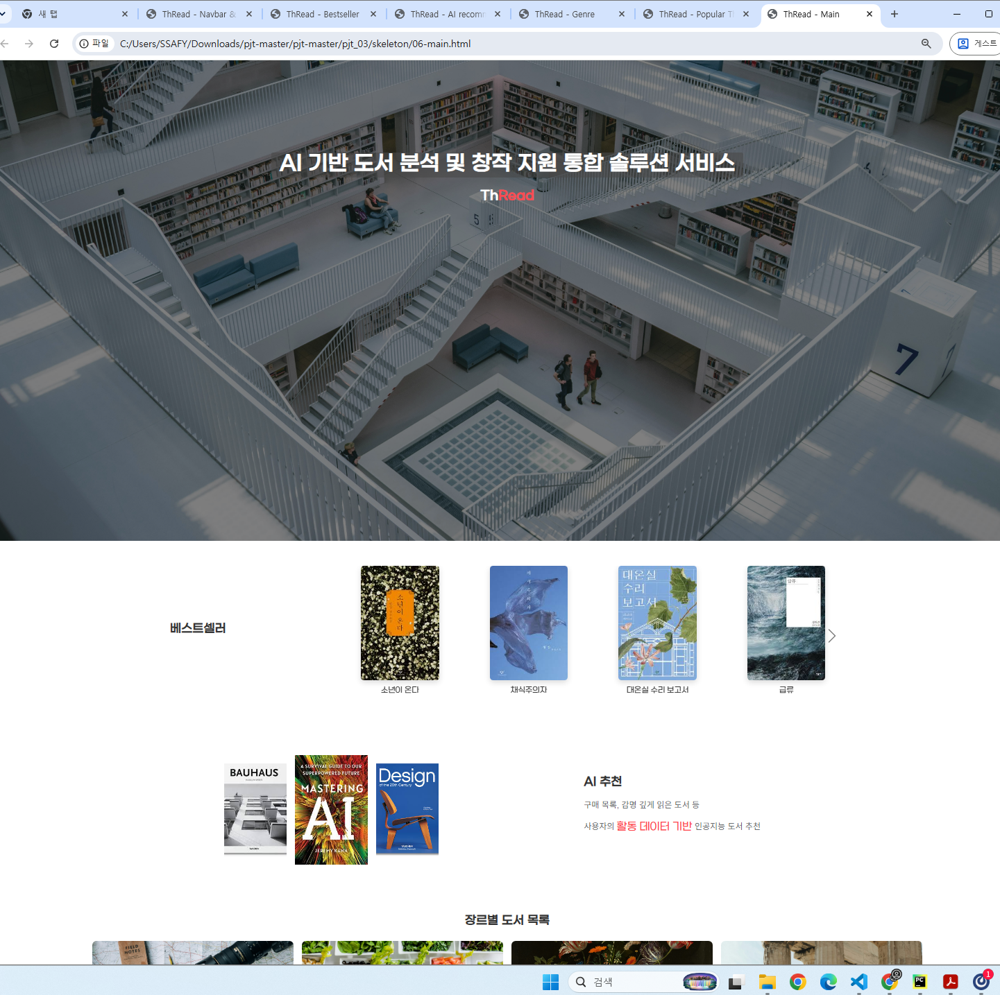
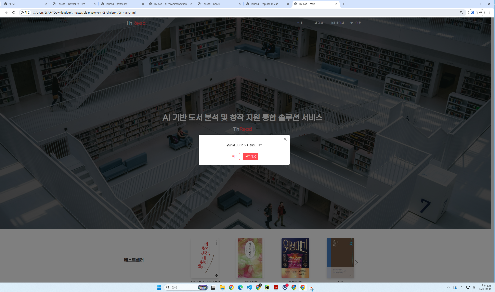
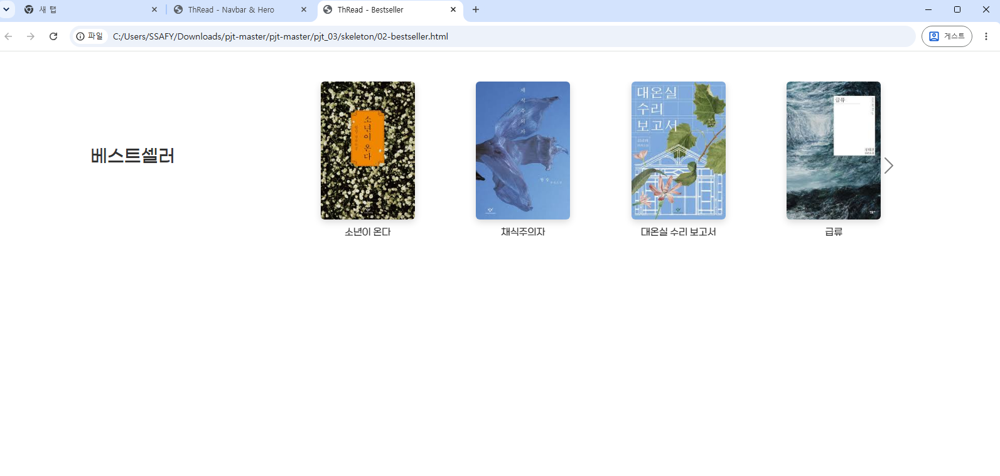
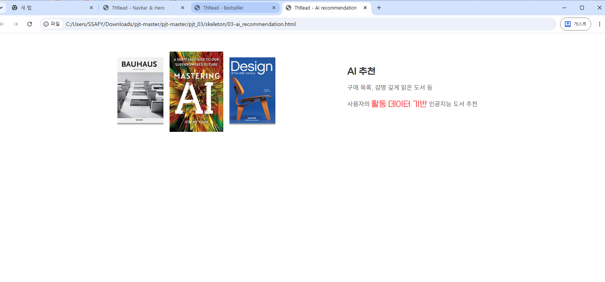
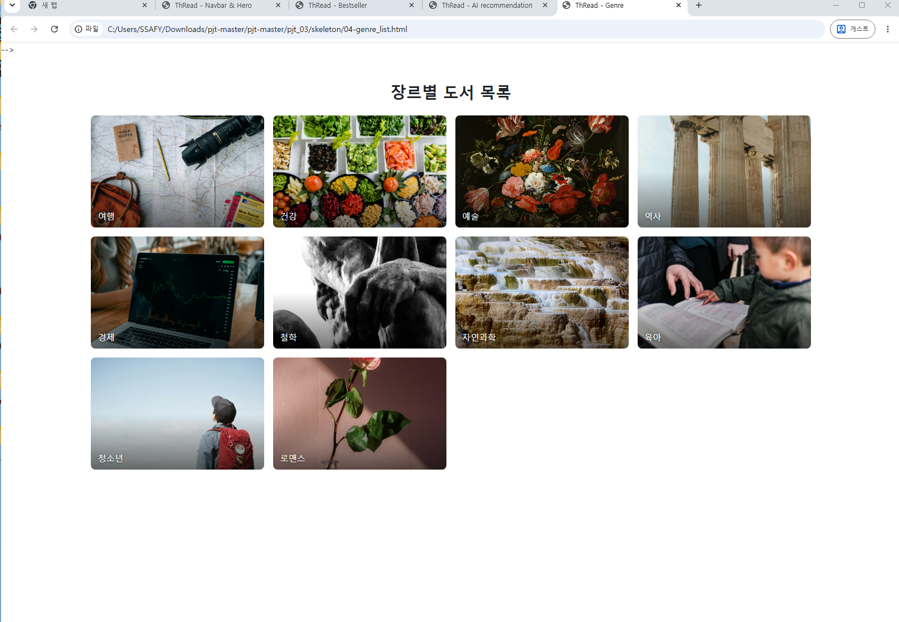
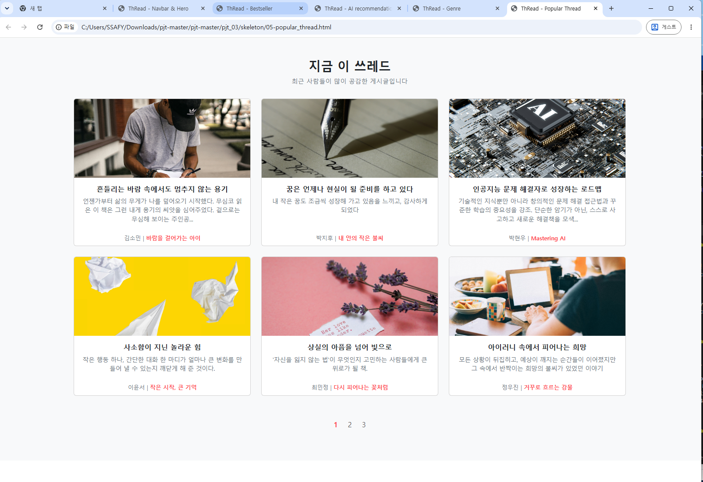

# ThRead - 반응형 웹페이지 구성

AI 기반 도서 분석과 창작 지원 통합 솔루션 서비스 ThRead의 메인 페이지를 Bootstrap으로 구현한 프로젝트입니다. 다양한 화면 크기에 맞춰 레이아웃이 변경되는 반응형 웹페이지를 구성했습니다.

## 팀원 및 역할

| 이름 | 담당
| 최주희 |F301 ~ F303|
| 피윤아 |F304 ~ F308|

## 요구사항 구현 현황

| 번호 | 분류 | 요구사항명 | 요구사항 상세 | 담당자 | 구현 파일 | 완료 |
| --- | --- | --- | --- | --- | --- | --- |
| F301 | 메인 페이지 | Navbar | 메인 페이지 상단의 Navbar 구현 | 최주희 | `01-navbar.html` | ☑ |
| F302 | 메인 페이지 | Hero | Navbar 아래 Hero 구현 | 최주희 |  | ☑ |
| F303 | 메인 페이지 | Bestseller | Bootstrap Carousel 컴포넌트를 활용하여 "베스트셀러" 섹션 구현 | 최주희 | `02-bestseller.html` | ☑ |
| F304 | 메인 페이지 | AI Recommendation | Bootstrap Grid System을 활용하여 "AI 추천" 섹션 구현 | 피윤아 | `03-ai-recommendation.html` | ☑ |
| F305 | 메인 페이지 | Genre List | Bootstrap과 Flexbox를 활용하여 "장르별 도서 목록" 섹션 구현 | 피윤아 | `04-genre_list.html` | ☑ |
| F306 | 메인 페이지 | Popular Thread | Bootstrap Card 컴포넌트를 활용하여 "인기 쓰레드 목록" 섹션 구현 | 피윤아 | `05-popular_thread.html` | ☑ |
| F307 | 메인 페이지 | 메인 페이지 결합 | 앞서 만든 메인 페이지의 구성 요소를 하나의 HTML로 결합 | 피윤아 | `index.html` | ☑ |
| F308 | 메인 페이지 | 로그아웃 확인창 | Bootstrap Modal 컴포넌트를 활용하여 "로그아웃 확인" 창 구현 | 피윤아 | | ☑ |

## 협업 방식

- 역할 분담: 요구사항 번호를 기준으로 나눠 작업했습니다. (F301~F303 / F304~F308)
- 파일 분리: 요구사항마다 HTML 파일이 나뉘어 있어서, 각자 맡은 파일만 수정해 충돌을 줄였습니다.
- 브랜치 사용: 각자 작업 브랜치에서 구현한 뒤 하나의 저장소로 합쳤습니다.
- 결합 작업(F307): 각자 만든 섹션을 `index.html`로 합쳐 메인 페이지를 완성했습니다.
- 소통: 진행 상황과 수정 사항은 함께 이야기 나누며 진행했습니다. 

## 사용 기술

- HTML5
- CSS3
- Bootstrap 5.3.3 (CDN)
- Visual Studio Code
- Google Chrome

## 구현 포인트

### F301 Navbar

- Bootstrap Navbar 컴포넌트로 메인 페이지 상단 내비게이션 바 구현
- 로고와 메뉴 링크를 배치하고, 좁은 화면에서는 토글 버튼으로 메뉴가 접히도록 반응형 적용
- 로그아웃 버튼 클릭 시 확인 모달(F308)이 열리도록 연결

### F302 Hero

- Navbar 바로 아래에 서비스를 소개하는 Hero 영역 구현
- 서비스 소개 문구와 버튼(CTA)을 배치
- 화면 크기에 따라 글자 크기와 여백이 자연스럽게 바뀌도록 구성

### F304 AI Recommendation

- Bootstrap Grid System(`row`, `col-*`)으로 "AI 추천" 섹션 구현
- 화면 크기별 열 개수가 달라지도록 `col-12`, `col-md-*` 등 브레이크포인트 클래스 활용
- 큰 화면에서는 가로로 나란히, 작은 화면에서는 세로로 쌓이는 반응형 레이아웃

### F305 Genre List

- Bootstrap과 Flexbox(`d-flex`, `flex-wrap`, `justify-content-*`)로 "장르별 도서 목록" 섹션 구현
- 장르 항목과 도서 목록을 정렬·간격 유틸리티 클래스로 배치
- 화면 폭이 좁아지면 항목이 자동으로 줄바꿈되도록 구성

### F306 Popular Thread

- Bootstrap Card 컴포넌트(`card`, `card-body`, `card-title`)로 "인기 쓰레드 목록" 섹션 구현
- 카드 여러 개를 Grid와 함께 배치해 반응형으로 출력
- 쓰레드 제목, 내용 일부, 작성자 등 정보를 카드 안에 구성

### F307 메인 페이지 결합

- 각자 만든 Navbar, Hero, Bestseller, AI 추천, 장르 목록, 인기 쓰레드 섹션을 하나의 `index.html`로 결합
- 섹션 순서와 간격을 맞추고, 중복되는 `<head>`, Bootstrap CSS/JS 링크는 한 번만 포함
- 섹션별 CSS를 통합하면서 클래스 이름이 겹치지 않도록 정리

### F308 로그아웃 확인창

- Bootstrap Modal 컴포넌트로 "로그아웃 확인" 창 구현
- Navbar의 로그아웃 버튼에 `data-bs-toggle="modal"`, `data-bs-target`을 연결
- 확인/취소 버튼을 배치하고, 취소 시 모달이 닫히도록 구성

## 어려웠던 점

- 제목을 좌측, 캐러셀을 우측에 두는 레이아웃으로 바꾸면서 `row`와 `col`이 중첩돼 `
` 닫는 태그의 개수와 순서를 맞추는 것이 까다로웠습니다.
- 이미지 크기를 150px × 220px로 고정할 때 `img-fluid`의 `max-width: 100%`가 크기 지정을 방해해서, 해당 클래스를 빼고 `object-fit: cover`로 비율을 맞췄습니다.
- Next 버튼을 바깥으로 빼려고 `right: -5%`를 썼더니 좁은 화면에서 버튼이 잘리고 가로 스크롤이 생겼습니다. 캐러셀이 우측 컬럼 안에 들어간 구조에 맞춰 `right: 0`으로 정리했습니다.
- 긴 도서 제목이 "센 / 가"처럼 글자 단위로 끊겨서 `word-break: keep-all`로 단어 단위 줄바꿈이 되게 했습니다.
- 브랜치와 저장소를 여러 개 오가면서 어느 폴더, 어느 브랜치에 올리고 있는지 헷갈렸고, 작업 위치를 `git remote -v`, `git branch`로 확인하는 습관의 중요성을 알게 됐습니다.

## 느낀 점

- Bootstrap의 Grid와 Carousel 컴포넌트를 직접 조합해 보면서 반응형 레이아웃이 어떤 원리로 동작하는지 이해할 수 있었습니다.
- 요구사항 문서에 적힌 조건(좌우 배치, 이미지 크기 고정, Next 버튼만 표시 등)을 하나씩 대조하며 구현하는 과정이 중요하다는 것을 느꼈습니다.
- 팀원과 파일을 나눠 작업하고 하나로 합치는 과정에서 Git 브랜치 관리와 커밋 정리의 중요성을 체감했습니다.
- 처음에는 에러가 났던 부분도 원인을 하나씩 확인하며 해결하니, 개발자 도구와 상태 확인 명령어를 적극적으로 활용해야겠다고 생각했습니다.

## 실행 화면

### F307 메인 페이지 결합 (F302 Hero 포함)

### F308 로그아웃 확인창 (F301 Navbar 포함)

### F303 Bestseller

### F304 AI Recommendation

### F305 Genre List

### F306 Popular Thread

